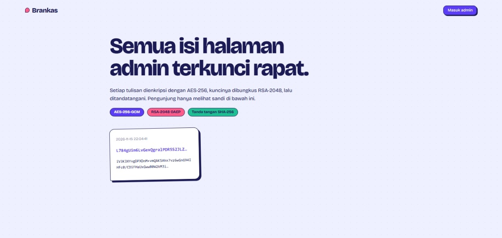
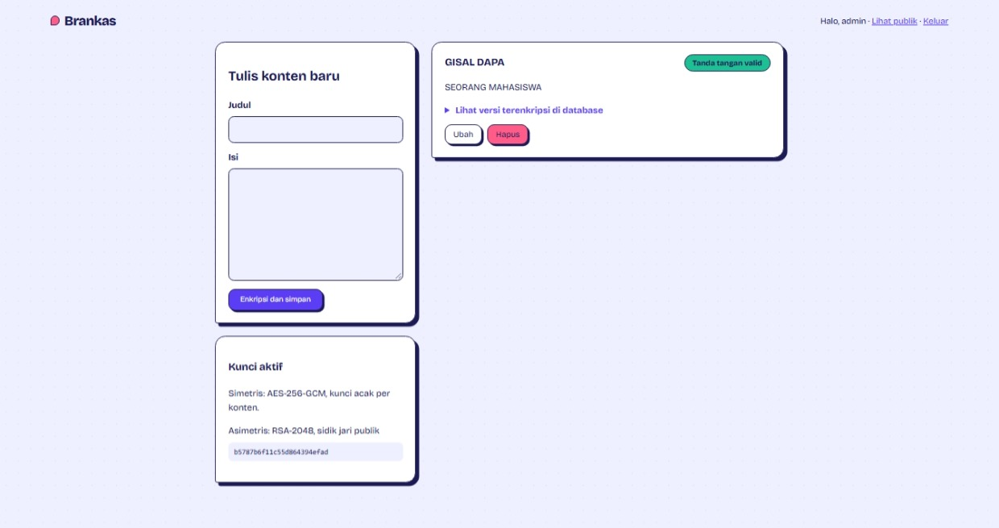

## 👨‍💻 Author

- **Nama:** Gisal Dapa
- **NIM:** 2430511023
- **Kelas / Program Studi:** 5A / Teknik Informatika 


# Brankas: Sistem Informasi dengan Kriptografi Simetris dan Asimetris

Aplikasi web berbasis **PHP** yang mengenkripsi seluruh konten di halaman admin. Konten disimpan di database hanya dalam bentuk terenkripsi, sehingga tidak ada teks asli yang tersimpan.

## Fitur
- Login admin (password di-hash dengan `password_hash`, perlindungan CSRF).
- Tambah, ubah, dan hapus konten (CRUD) dengan enkripsi otomatis.
- Halaman publik hanya menampilkan ciphertext.
- Halaman admin menampilkan teks asli hasil dekripsi, ciphertext di database, dan status tanda tangan digital.
- Setup otomatis: database, tabel, kunci RSA, dan akun admin dibuat sendiri saat pertama dibuka.

## Skema Kriptografi (Hybrid Encryption)
| Lapisan | Algoritma | Fungsi |
|---|---|---|
| Simetris | AES-256-GCM | Mengenkripsi judul dan isi konten dengan kunci acak per konten |
| Asimetris | RSA-2048 (OAEP) | Membungkus kunci AES dengan public key, dibuka dengan private key |
| Asimetris | RSA-SHA256 | Tanda tangan digital untuk mendeteksi perubahan data |

**Alur simpan:** kunci AES acak dibuat, judul dan isi dienkripsi dengan AES-GCM, kunci AES dibungkus RSA public key, lalu ciphertext ditandatangani dengan RSA private key.

**Alur baca:** tanda tangan diverifikasi dengan public key, kunci AES dibuka dengan private key, lalu konten didekripsi dengan AES.

## Struktur Proyek
```
securevault/
├── config.php      # koneksi DB, setup otomatis, fungsi kriptografi
├── index.php       # halaman publik (ciphertext)
├── login.php       # login admin
├── admin.php       # dashboard admin (CRUD konten)
├── logout.php
├── setup.php       # opsional, hanya memicu setup lalu redirect
├── database.sql    # skema database (referensi)
├── assets/style.css
└── keys/           # kunci RSA dibuat otomatis (tidak masuk Git)
```

## Struktur Database
- `users`: `id`, `username`, `password_hash`, `created_at`
- `contents`: `id`, `title_enc`, `body_enc`, `enc_key`, `signature`, `created_at`

## Cara Menjalankan

### Opsi 1: Laragon / XAMPP
1. Salin folder ke `C:\laragon\www\securevault` (atau `htdocs` untuk XAMPP).
2. Jalankan Apache dan MySQL.
3. Buka `http://localhost/securevault` (Laragon: `http://securevault.test`).

### Opsi 2: PHP built-in server
```bash
cd securevault
php -S localhost:8000
```
Buka `http://localhost:8000`.

> Jika MySQL tidak tersedia, aplikasi otomatis memakai SQLite (`keys/data.sqlite`).

## Akun Admin
| Username | Password |
|---|---|
| `admin` | `admin123` |

Ubah di `config.php` (`ADMIN_USER`, `ADMIN_PASS`) sebelum pertama kali dijalankan.

## Kebutuhan
- PHP 8.0+ dengan extension `openssl` dan `pdo_mysql` atau `pdo_sqlite`
- MySQL/MariaDB (opsional)

## Catatan Keamanan
- Folder `keys/` berisi private key dan tidak ikut di-commit (lihat `.gitignore`).
- Ganti `KEY_PASS` di `config.php` sebelum dipakai di luar tugas.
- Jangan hapus folder `keys/` setelah ada data, karena konten lama tidak bisa dibuka tanpa private key yang sama.
- Proyek ini dibuat untuk tujuan pembelajaran.

## Screenshot Website
## 📸 Tampilan Aplikasi

| Halaman Publik (User) | Halaman Admin (Dashboard) |
| :---: | :---: |
|  |  |
| *Tampilan antarmuka untuk pengguna umum* | *Panel kontrol khusus administrator* |